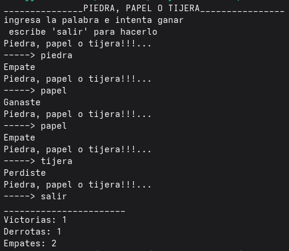

# Adivinar el número

Juego por consola donde el usuario escribe "piedra", "papel" o "tijera", y la maquina decide al mismo tiempo, se lleva el conteo de cada resultado por ganar, perder o empatar y al final.
El usuario juega las veces deseadas hasta escribir "salir" por consola.

## Características

- Manejo de errores
- Conteo de victorias, perdidas y empates
- Bucle continuo para jugas varias veces
- Opción clara para salir escribiendo `salir`

## Requisitos

- Java 11 o superior

## Tecnologías utilizadas

- Java

## Cómo ejecutar el proyecto

1. Clona el repositorio:
```bash
git clone https://github.com/JavFloresDev/Piedra-Papel-Tijera
```
2. Entrar a la carpeta del proyecto:
```bash
cd Piedra-Papel-Tijera
```
3. Compila el programa:
```bash
javac --release 11 src/PiedraPapelTijera.java
```
4. Ejecuta el programa: 
```bash
java -cp src PiedraPapelTijera
```

## Ejemplo de uso

**PIEDRA, PAPEL O TIJERA**\
ingresa la palabra e intenta ganar\
 escribe 'salir' para hacerlo\
Piedra, papel o tijera!!!...\
-----> piedra\
Empate\
Piedra, papel o tijera!!!...\
-----> papel\
Ganaste\
Piedra, papel o tijera!!!...\
-----> papel\
Empate\
Piedra, papel o tijera!!!...\
-----> tijera\
Perdiste\
Piedra, papel o tijera!!!...\
-----> salir\
_______________________\
Victorias: 1\
Derrotas: 1\
Empates: 2\


## Estructura del proyecto

```
Piedra-Papel-Tijera/
├── src/
│   └── PiedraPapelTijera.java
├── README.md
└── LICENSE
```

## Capturas de pantalla

Funcionamiento del Juego\


## Autor

JavFloresDev — Jhonny Flores

## Licencia

Este proyecto está bajo la licencia MIT. Consulta el archivo LICENSE [blocked] para más detalles.
